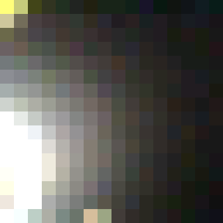
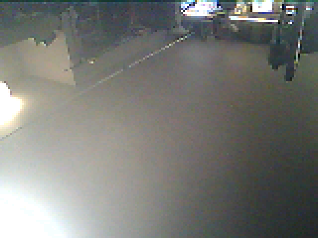

# Proof of concept: the XIAO ESP32S3 Sense camera on the lights

Branch `xiao-camera-poc`, parked to learn from, not to merge. Built and run on 2026-11-13 on a Seeed XIAO ESP32S3 Sense (USB serial F0:9E:9E:20:C2:24) with its OV3660 camera.

The real change belongs in ewowi's plan "Video in, LED walls out", as a camera source behind the registry its step 1 builds. This branch answers one question first: does the camera reach the lights through the parts MoonLight already has?

## What it shows

The camera feeds the Picture effect through the existing capture seam (`videoCapture*` in `platform.h`). On this firmware the Picture service's `usb capture` source shows the camera; the service and the effect are unchanged.





## Measured

| | Value | How |
|--|--|--|
| Picture at 16 x 16 | "live, 16 x 16 from 96x96 at 24 fps", 24 to 25 fps over three reads | the Picture service's status |
| Picture at 160 x 120 | "live, 160 x 120 from 160x120 at 19 fps" | the same, grid and picture at 160 x 120 |
| Render rate | 305 fps before the camera, 328 with it at 16 x 16; 14 fps at 160 x 120 | `bench status xiao` |
| Heap | 8,418,348 bytes free before, 8,340,068 with the camera at 16 x 16: about 78 KB | the same |
| Flash | 2,581,442 bytes, 90,844 more than the catalog image (2,490,598) | build runs `xiao-build-1112-105148-265` and `xiao-build-1113-085112-284` |
| Color | mean R 121, G 122, B 118 at 160 x 120: neutral | `snapshot.py` |

The 14 fps at 160 x 120 is the 19,200 lights the LED driver and the preview carry, not the camera, which still delivers 19 fps.

## How it is built

- `src/platform/esp32/platform_esp32_camera.cpp`, new: the seam on an S3 built with `MM_DVP_CAMERA`. It opens the sensor through Espressif's `esp32-camera` 2.1.9 (Apache-2.0) in RGB565 at the smallest frame size covering the picture, two frame buffers in PSRAM, the newest frame winning. The decode shrinks a frame by a whole-number step into the RGB888 picture.
- `esp32/main/Kconfig.projbuild`: the switch `MM_DVP_CAMERA`.
- `esp32/main/idf_component.yml`: `espressif/esp32-camera` on that switch.
- `esp32/sdkconfig.defaults.esp32s3-n8r8`: the switch on, for this branch only.
- `src/platform/esp32/platform_config.h`: `hasUsbVideo` also holds on an S3 camera image, so the service offers its capture source.
- `src/platform/esp32/platform_esp32_usbvideo.cpp`: its stub stays out of the camera image.
- `esp32/main/CMakeLists.txt`: the new file.

## Where the settings come from

| Setting | Value | Source |
|--|--|--|
| Pins | XCLK 10, SIOD 40, SIOC 39, VSYNC 38, HREF 47, PCLK 13, Y2 to Y9 = 15, 17, 18, 16, 14, 12, 11, 48, no PWDN or RESET | arduino-esp32 `camera_pins.h`, `CAMERA_MODEL_XIAO_ESP32S3`; the same in s60sc's `camera_pins.h` |
| XCLK | 20 MHz | s60sc's ESP32-CAM_MJPEG2SD runs this board at 20 MHz (AGPL-3.0: a fact, no code); Seeed's wiki uses 20 MHz |
| OV3660 correction | vertical flip, brightness +1, saturation -2 | easytarget's esp32-cam-webserver (LGPL-2.1): the values, not the code |
| SCCB | I2C port 1 | keeps the camera's bus off port 0 |
| XCLK timer | LEDC timer 3, channel 7 | away from the PWM light driver's first ones |

easytarget's firmware defaults to 8 MHz, citing artifacts at 20 MHz on many modules (esp32-camera issue #150). At 20 MHz this board shows none in the snapshots; 8 MHz is the fallback if one appears.

## What it skips, which the real change needs

- **A source of its own.** It borrows `usb capture`, so an image cannot have both. The spec gives the camera its own source behind ewowi's registry.
- **Pins as controls.** They are compiled in for the XIAO. The spec has a `board` preset select with a `Custom` row, as the SD card service has.
- **The LCD_CAM reference.** The camera and a parallel LED driver share the S3's LCD_CAM block, and IDF's i80 bus resets it when its own count is zero. The XIAO drives LEDs over RMT, so the shared block stays the camera's alone. The spec takes IDF's reference around the camera.
- **A bounded wait.** `esp_camera_fb_get` waits on the driver's own timeout, about 4 s, so a stop can wait that long if the sensor stalls.
- **Tests.** None: the desktop has no camera device in its test grabber yet.
- **Its own firmware.** It switches the camera on in `esp32s3-n8r8`; the spec gives it `esp32s3-n8r8-cam` so other boards carry none of it.

## Learned

- **The picture is independent of the layout.** The Picture service's width and height size the picture, up to 512 a side, and the camera fills it from the smallest sensor size that covers it; the Picture effect samples it onto whatever layout is there.
- **The preview caps a snapshot at about 21,000 lights.** A `/wsp` frame stays under 64 KB, so 160 x 120 is the largest grid one preview frame carries. A larger shot, up to the OV3660's 2048 x 1536, needs a route serving the camera's own frame.
- **Two modules in one state document cannot share a name.** A service called `Picture` and an effect called `Picture` refuse the document ("that name is used twice in the document"); the effect here is `Camera`.
- **The XIAO's prior power-loss count.** Before this branch the board came up in safe mode after "250 failed boots in a row (POWERON)", short power losses rather than crashes. A restart cleared it; the cause, the hub or the supply, is open.

## Run it again

The built firmware is in `firmware/`, the image that ran on the board (build `xiao-build-1113-085112-284`, flash `xiao-flash-1113-085925-555`):

| File | Offset | md5 |
|--|--|--|
| `xiao-camera-poc-merged.bin`, the four below in one | 0x0 | `0c8410aaab0ceaa67e071e4061c5ff0e` |
| `bootloader.bin` | 0x0 | `8ddafbf72c34448e7371d9660b420437` |
| `partition-table.bin` | 0x8000 | `fc469e7e268a23c993b395f1f59a3530` |
| `ota_data_initial.bin` | 0xe000 | `84d04c9d6cc8ef35bf825d51a5277699` |
| `MoonLight.bin` | 0x10000 | `4ba0d9294f66fdefb6ff098bccccf161` |

`flash_args` holds the offsets and the flash settings. The four files at their offsets leave NVS (0x9000 to 0xE000, the WiFi credentials among it) as it is:

```
esptool --chip esp32s3 --port <the XIAO's port> write-flash @docs/work/poc-xiao-camera/firmware/flash_args
```

Run that from `docs/work/poc-xiao-camera/firmware/`, where the paths in `flash_args` resolve. The merged image is one write from 0x0 and blanks NVS on the way, so the board comes up on its access point, to be given its WiFi again; the settings files on the filesystem (0x610000) stay:

```
esptool --chip esp32s3 --port <the XIAO's port> write-flash 0x0 xiao-camera-poc-merged.bin
```

Or build and flash it from this branch:

```
bench run xiao build --arg tree=MoonLight-xiao-s3-sense
bench run xiao flash --approved --arg tree=MoonLight-xiao-s3-sense --arg port=<the XIAO's port>
```

Then, live, so a restart undoes it:

```
curl -X PATCH 'http://MM-C224.home/api/state?live=1' --data-binary '{"Services":{"Picture":{"type":"PictureService","source":1,"width":16,"height":16}},"Effects":{"Layer":{"Pulse":{"enabled":false},"Camera":{"type":"PictureEffect"}}}}'
```

A snapshot of the lights: `uv run --no-project docs/work/poc-xiao-camera/snapshot.py MM-C224.home 16 16 shot.png 20`.

## Related

- The camera spec, as a card draft: `~/Documents/src/upstream-notes/backlog-cards-2026-11-12.md`, "A board camera as a Picture source".
- The proposal to ewowi: `~/Documents/src/upstream-notes/camera-step-proposal-2026-11-13.md`, not posted.
- Pins and claims with sources: `~/Documents/src/private/xiao-s3-sense/research.md`.
